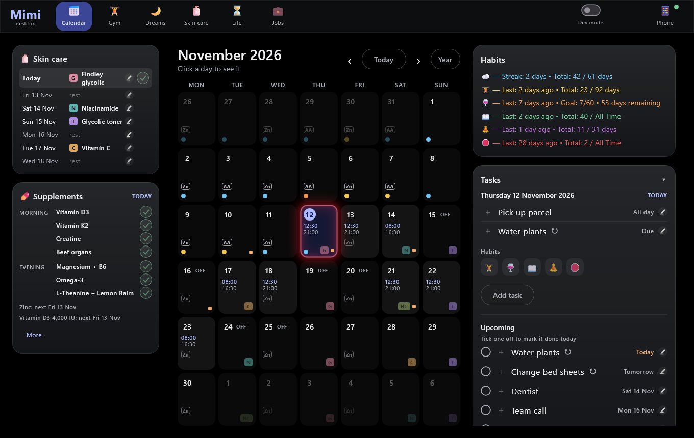
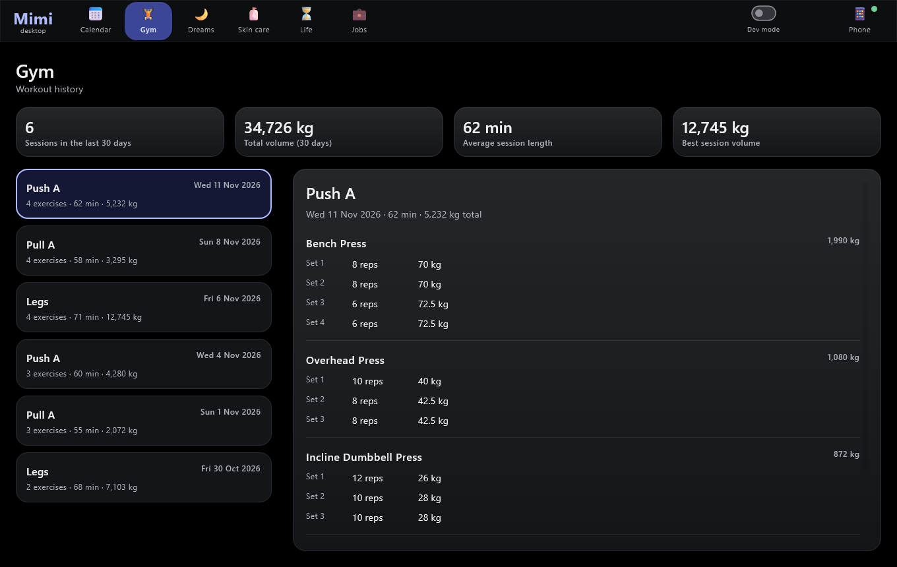
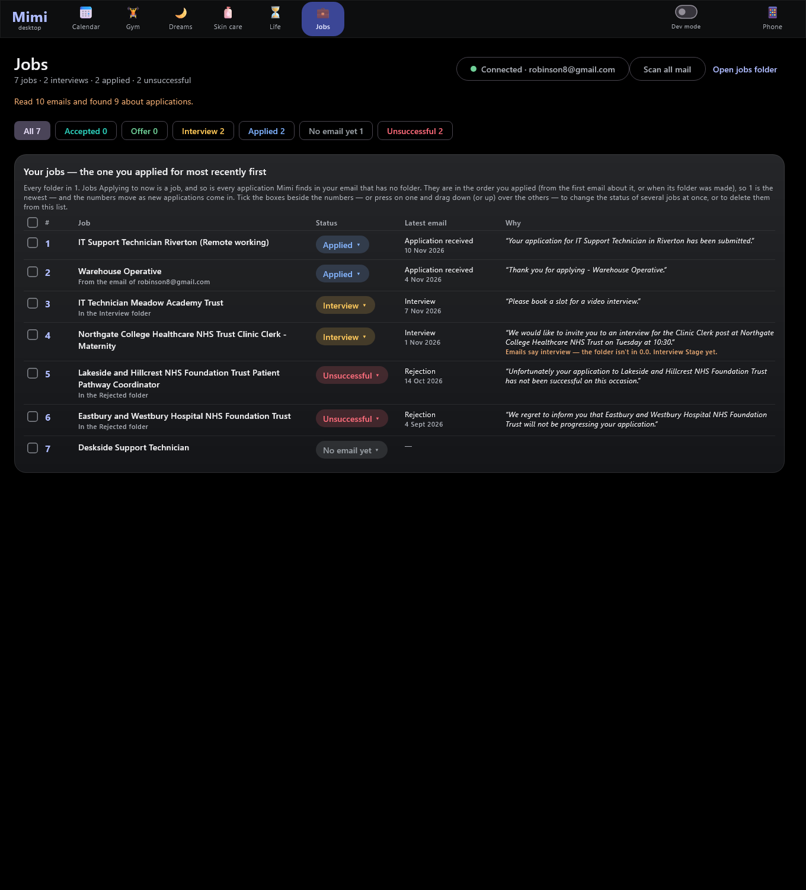

# Mimi — desktop


**Mimi** is a personal life-organiser made of two apps I designed and built: an Android app (habits,
calendar, tasks, gym log, dream journal) and this **Windows desktop companion**, which syncs with the
phone over home Wi-Fi and adds a big-screen calendar, a skin-care and supplements planner, and a
job-application tracker that reads Gmail.



| Gym history | Job tracker (Gmail) |
|---|---|
|  |  |

*Screenshots are rendered from the app's built-in sample data (`gradlew renderPreviews`), not real records.*

## Try it (Windows 10/11, no install)

1. Download `Mimi-desktop-1.0.0-windows-x64.zip` from the [latest release](https://github.com/REralph/mimi-desktop/releases/latest)
   and unzip it. Java is included.
2. Double-click **`Start Mimi demo.bat`**. The app opens with invented sample data and a pretend phone,
   and nothing is read from or saved to your PC.

Windows may warn that the app isn't code-signed: click **More info** → **Run anyway**. `Mimi.exe` on its own
is the real app, which pairs with the Mimi phone app over Wi-Fi.

## Highlights

- **Phone ↔ PC sync with its own secure protocol.** The phone runs a small HTTP server and the PC
  polls it. Requests are signed with **HMAC-SHA256** (timestamp + nonce, so they can't be replayed),
  and responses are gzipped and encrypted with **AES-256-GCM** using keys derived from a 100-bit
  pairing key. Pairing is a **QR code** scan, and the PC finds the phone on the network by itself.
- **The phone is the source of truth.** Edits made on the PC (habits, events, tasks, dreams,
  skin-care choices) are sent as commands the phone validates and saves. Edits made while the phone
  is unreachable wait in an **offline outbox**, and timestamps settle conflicts (the later change wins).
- **Gmail integration (read-only OAuth)** that classifies application emails (applied, interview,
  offer, rejection) and merges them with job folders on disk into one status table.
- **Rules-based planners**: an evening skin-care plan that spaces out exfoliating nights and can use
  a UV forecast (Open-Meteo), and a supplements schedule checked against NHS/EFSA upper limits.
- **Well tested**: 833 automated tests (unit, UI and **interop tests** that compile the phone's real
  link code and run the desktop client against it, so the two sides can't drift apart).
- Custom dark "glass" UI in Compose Desktop with its own window frame, an emoji picker and a
  developer mode that labels every UI section with a reference number.

## Tech stack

Kotlin 2.4 · Compose Multiplatform (Desktop) · Material 3 · kotlinx.serialization · Java HTTP client ·
javax.crypto (AES-GCM, HMAC) · ZXing (QR codes) · Gmail REST API with OAuth 2.0 · Gradle · jpackage (MSI)

The Android half (Kotlin, Jetpack Compose, Room, WorkManager) lives in a separate private repository
because it holds personal data.

## Build and run

Requires JDK 17+ on Windows.

```bash
gradlew run                 # start the app
gradlew run --args=--demo   # start it with sample data and a pretend phone (see DemoMode.kt)
gradlew test                # run the test suite
gradlew renderPreviews      # render every page to PNG with sample data (build/previews)
gradlew createDistributable # self-contained app folder with Mimi.exe (build/compose/binaries)
install.bat                 # build and install as "Mimi" with Desktop and Start-menu shortcuts
```

Without a paired phone the real app shows only the **Phone** page. Everything else needs a phone running
the Mimi Android app on the same Wi-Fi, or the demo mode.

---

## User guide

The rest of this file is the detailed guide to every page.

Mimi desktop is a Windows companion to the Mimi phone app (Kotlin + Compose Desktop, same dark glass
look and Material 3 as the phone). It shows a **copy of the phone's data** — the phone is the source of
truth. Everything is read-only here except what you do on purpose, and that is always sent to the
phone, which checks it and does the saving itself: a dream you press **Save dream** on, a habit you
tap on a day, an event or a task you add. Until a phone is paired it shows no data,
only the Phone page to connect one.

## Pages
- **Skin care** — your products, the evening plan (UV forecast for your town optional), see below
- **Calendar** — month grid with your work times, each evening's skin-care product and the zinc days (faded for days still to come), today's cell in a glowing red neon frame, at 45% of its first brightness — half, then 10% lower (`ui/NeonFrame.kt`, one number `NEON_BRIGHTNESS` sets it; it replaces the lilac border the selected day has, so today shows as selected by its tint), in three columns: on the **left** the **Skin care** schedule (where you tick tonight off) and the **Supplements** card (where you tick off what you've taken — by name and time of day, never how many), in the middle the month grid, and on the **right**, from the top, the **Habits** information (the phone's exact numbers) and the **Tasks** card (the selected day — a table of what is on it, then its habits as emojis — and under it the Upcoming list, where events and tasks are listed, each with its emoji and a tick for done). Pick a day, tap a habit's emoji to record it on that day (tap again to clear), or press **Add task** for it. Click the month's name (or **Year**) for the **Month Overview** — the whole year as one table, see below
- **Gym** — workout history with sets
- **Dreams** — list + editor (drafts / saved) with Copy, Paste and Save dream (see below)
- **Jobs** — the jobs you are applying for, in a table with where each one stands (applied, interview, offer, accepted, unsuccessful), worked out from your job folders and from the emails in your Gmail; a **Connect Gmail** button in its header (PC7.1) that says whether the mail is connected and to which address, and opens where you connect (robinson8@gmail.com). Lives on this PC only and needs no phone — see "Jobs" below
- **Life** — 80 years as 960 monthly circles (date of birth comes from the phone); the grid zooms with the window — circles, rows and age labels grow when you make the window bigger and shrink when you make it smaller
- **Phone** — pairing, connection status, what has been shared

## Connect to your phone (once)
1. Phone and PC on the same Wi-Fi, with the updated Mimi app on the phone.
2. On the PC: the **Phone** page shows a **QR code**.
3. On the phone: ☰ menu → **Desktop link** → **Scan PC code**, and point it at the code.

That's all. The phone takes the code's key as its own, and the PC finds the phone by itself and saves the pairing. (No typing; if
you ever want to, **Enter address and key instead** on the Phone page — and **Pair by hand** on the phone's page — still do it the old way.
From a terminal the same thing is `gradlew pair -Pa2.address="…" -Pa2.key="…"`.)

After that the app remembers the phone and shows its last data on start, then syncs with it by itself: once as the app opens, every 15
seconds while the phone answers, and every 8 seconds while it doesn't, so the connection returns on its own as soon as the phone can be
reached. **Sync now** is only there if you're impatient.

**If the phone's address changes** (a router can give it a new one), the app notices the phone has gone from where it was, asks the other
devices on this PC's own network whether a Mimi phone is there, and carries on with the new address. The phone shows a short fingerprint of
its key (never the key), so the app only ever sends its key to its own phone.

**If the phone can't be reached** the Phone page says so, and says when **a VPN is running on this PC** — a VPN can stop the PC reaching
anything on the home network, and then nothing on the network (not even the router) answers. Pause the VPN, or let it reach local
devices, and the connection comes back by itself.

On the phone, Desktop link stays on in the background without any notification (Android requires a background service to post one; Mimi's
is on a channel that is switched off, so nothing shows in the notification shade, the status bar or the lock screen). The Desktop link
page has the switch **Keep it on**, on by default, and an **Allow in background** button so Android doesn't pause it while the screen
is off. It starts when the Mimi app opens and again after the phone restarts. With the switch off it only works while the page is open.

How it is protected: the connection is plain HTTP on your Wi-Fi, so nothing relies on the network being private. Every request is signed
with the pairing key (100 random bits), every reply is encrypted with it, requests can't be replayed, and the phone ignores anything from
outside your local network. "Create new key" on the phone (or "Forget" here) cuts the link. The code on the Phone page holds a key made
for that pairing; it is only on screen while you are pairing.

Stored on this PC in `%APPDATA%\a2-desktop`: the pairing, the last copy of the phone's data, and `outbox.json` (changes waiting for the
phone, see below) — plain JSON, readable by your Windows user. "Forget" deletes them.

### Changes made while the phone can't be reached
You can still add, change and delete **events and tasks**, record **habits**, and tick **skin care and supplements**, when the phone isn't reachable (it is off the Wi-Fi,
asleep, or a VPN is in the way). The change shows on screen at once — a deleted event stays gone, a new one appears — and is kept on this PC
(`outbox.json`, so closing the app loses nothing). **The next time the phone answers**, the waiting changes are sent to it in the order they
were made, each dated with the moment it was made; then the screen shows what the phone now holds.

If something was changed on **both** sides meanwhile, **the later change wins**: the phone remembers when it last changed each event and
task, and keeps its own if that is later than the PC's change. The PC then drops its change and says so on the Phone page ("Delete event
“Haircut”: the event was changed on the phone after that change was made, so the phone's version was kept"). Deleting something the phone
has already deleted is simply done; changing something the phone has since deleted is dropped with a note. Something added and then
deleted (or changed) while offline is added once as changed, or never sent. A change whose answer is lost on the way is sent again with
the same request number, so the phone never adds it twice. The Phone page lists what is waiting. (Not queued: dreams saved with **Save
dream**, which still needs the phone to answer and says so if it doesn't.)

**Skin-care and supplement ticks are queued the same way** (they used to be refused). A tick, an un-tick, a chosen product or a changed
setting made while the phone is out of reach is shown on the cards at once — the tick is drawn, and can be tapped off again — and waits in
the same list (the Phone page says "Skin care change" or "Supplements change"). When the phone answers it is sent, in order, dated with the
moment it was made, and the cards then show what the phone holds. A tick and its un-tick on the same evening collapse into the later one.

**For each thing in the record the later change wins, whichever side made it.** The phone remembers when each *thing* last changed — one
evening (its tick, its product, a no), one supplement on one day, one setting, one extra product — whether the change was made on the
phone or came from the PC. A waiting PC change is applied only to the things the phone has **not** changed since the PC made it: tick an
evening on the PC while offline, and if the phone un-ticks that same evening later, the phone's stays; if the PC's was later, the PC's is
kept. Things the phone didn't touch are taken from the PC as made. (The two clocks are the devices' own, so they should be right to within
a few seconds — both set themselves from the internet.) The moment is only sent to a phone app that announces it understands it
(`features` in its snapshot, `care.stamps`); an older phone app is sent the plain request, which it applies as before (so it can't
tell which change is later — update the phone app for that).

## Install and run
**Normal use:** open **Mimi** from the shortcut on your Desktop (or the Start menu). It is a
standalone program — no console, no Gradle — installed in `%LOCALAPPDATA%\Programs\Mimi`.

**Install or update:** double-click `install.bat` in this folder. It builds the app, replaces the
installed copy (closing it first if it's running) and refreshes the shortcuts. Your pairing and phone
data are never touched. (`install.bat -NoBuild` reinstalls the last build without rebuilding.)

**If something goes wrong:** every problem is written to `%APPDATA%\a2-desktop\crash.log`. If the
app ever has to close it says so and shows that path. Send me that file.

**For development**
- `run.bat` / `gradlew.bat run` — run straight from the source
- `gradlew.bat test` — unit tests; interop tests that run this app against the phone project's real
  link server (when `..\..\AndroidStudioProjects\a2` is present); and a smoke test that clicks
  around every page hundreds of times, with sample data, phone data, an unreachable phone and an
  empty phone, failing on any exception
- `gradlew.bat renderPreviews` — one PNG per page in `build/previews` (no window needed)
- `gradlew.bat renderIcon` — redraws the app icon

## Layout
- `model/` — data classes for what the desktop shows
- `data/DesktopStore.kt` — all app state; fed by `applySnapshot` (sample data or the phone's)
- `link/` — the phone link: `LinkProtocol.kt` and `LinkCrypto.kt` are **copies** of the phone
  project's `link/` files (the interop test fails if they drift apart), plus client, storage and
  controller
- `logic/` — the phone's Sober rule, streaks, Information lines and Life-in-Months counting, copied
  so both apps show the same numbers
- `ui/` — one file per page, plus the navigation bar along the top
- `ui/TitleBar.kt`, `ui/WindowResize.kt`, `Main.kt` — the window's own frame (see below)

## Habits, events and tasks from the desktop
At the very top of the Calendar's right-hand column is the **Habits** information card (PC1.6, the phone's exact numbers); under it is **Tasks**: one card holding the selected day and the Upcoming list (they used to be two cards; the
"Tasks" header opens and closes it). Its top part is the selected day — select a day in the Calendar and it shows, top to bottom: the date; a **table of
everything on that day** (see below); and the **Habits** that can be recorded by hand, as just their emoji (the name appears when
the pointer rests on one). Tap a habit to record it on that day on your phone, tap it again to clear it. Pick another day and the
whole card changes with it, past or future. There is no Sober line and no work-times line in it. **Add task** is the one button for
adding (there used to be two, Add event and Add task): an emoji, a name, and how it repeats — *Doesn't repeat* (something to do once), or
every N **days / weeks / months / years**, so "water change every 2 weeks" is one task — add it to that day and it joins the Upcoming list.
(Events can no longer be *added* from the PC; the ones already on the phone still show, and can still be edited, deleted and marked done.)
It goes to the phone, which checks it and writes it with the same code its own
screens use (so a habit you've linked to another behaves exactly as if you'd tapped it on the phone);
the desktop then shows what the phone says it now holds and re-syncs. Sober can't be recorded by
hand — it is worked out from your other habits, as on the phone. If the phone can't be reached
nothing changes anywhere and you get a message. The phone lists "Last change from the desktop" on its
Desktop link page. Same security as dreams (signed, encrypted, replay-proof, local network only).

### What the Selected day card lists
The table under the date comes from the phone's own data — its events and its Upcoming list — not from a list of its own, and the
month grid draws its emoji from the very same list, so the two always agree. Each row is an emoji, the title — followed by a small
**repeat symbol** (↻, a circle of arrow) if it comes round again, with how in its hover tip ("Repeats · Every week"); there is no
"Task · Every week" line under it any more, in this table or in the Upcoming card — and on the right when: an event's time or *All day*, a task's *Due* (or *Overdue* once its day
has passed), or *Done*. A day with nothing on it just says *Nothing scheduled*.
- **On its own day:** the events dated that day and the tasks due that day. An event the phone has completed shows as *Done*.
- **Repeating ones:** the phone only sends the *next* date of a repeating event or task, plus how it repeats ("Every week",
  "Every 14 days", "Every 2 months"…). The PC steps on from that date exactly as the phone does (from the previous date each time)
  and lists the item on every later date after today — **until you tick that occurrence off here**: from then on the repeats still to
  come count from the **day you ticked it done**. Change Bed Cover every 6 days, due 17 Oct but done on the 8th, has its shadow on the
  14th, 20th and 26th rather than the 10th, 16th and 22nd; done a day or two early, the next is that many days after the day it was
  really done; tap the tick again and the old count comes back. The phone isn't told (it has no way to complete a task for the PC), so
  its own date doesn't move. A smart day (below) is worked out from the same starting day. Nothing is shown for the weeks between an
  overdue item's due date and today: it stays on its due date until it is completed. A weekly task pinned to a weekday reaches the
  PC as just "Tuesday", without how many weeks apart, so it can't be worked out and shows only on its own date.
- **Ticked off here:** an item ticked in the **Upcoming** card moves to the day it was done (as *Done*, its emoji in full colour)
  and leaves its due date.
- **The small pen** at the right end of a row (here and in the **Upcoming** card) opens a window to change or delete that event
  or task *on the phone*, to give it an emoji, or to mark it done on a day (see *Mark as done* below). An event has its emoji, title, date (day/month/year; for a repeating one, the next time it happens),
  time (empty = all day) and repeat every N days (once that is a week or more it also has **Which day?**, see *Smart days* below); a task has its emoji, name, due date and repeat. **Save** sends the change to the
  phone, which checks it with its own rules and makes it with the code its own screens use — the same event or task is changed,
  never a copy, and its reminder, history and other settings are kept — and the desktop then re-syncs. **Delete** asks first, then
  deletes the event from the phone, or (a task) switches it off the way the phone's own Delete does: it stays in Manage Tasks there,
  with its history. Where the PC can't tell how an item repeats (a weekly task the phone sends as just "Tuesday", an event that
  isn't on the Upcoming list) the window says so and leaves the repeat as it is. A new title that another thing on the list already
  has is refused; renaming carries the emoji and the done tick to the new title. This needs the updated phone app (an older one
  answers that it is too old).
- **Mark as done** is the last part of every edit window: *Done on* a day (typed as day/month/year, with the weekday shown under it, or
  the **Today** / **Yesterday** buttons) and **Mark done**. Any day up to today works — the day it was really done, when the tick was
  forgotten — a day that hasn't come yet is refused. It does exactly what ticking the item in Upcoming on that day does: the item moves
  to that day, in full colour, and its row says *Done Mon 12 Oct*. Once done the part says so, with **Undo**. Kept on this PC only
  (the phone isn't told, see the last point below), so it works with the phone out of reach too.
- **Make it repeat — the pen on something done once.** A row that is only a tick kept on this PC, with nothing of that name on the
  phone's Upcoming list (a haircut had on Wed 4 Nov whose repeating event was deleted, say), has the same small pen. It opens
  **Make it repeat**: how often (**every 2 weeks** to start with; days or weeks, any number), **Next one due** (that long
  after the day it was done — change it by typing another day) and **Which day?** (**On a day off** to start with, or what that title
  already has). **Repeat it** adds an **all-day event** with that title to the phone that repeats every that-many days (the window says
  so), so the phone gets the plain date and repeat; the choice of day is kept here. It is an event, not a task, because the phone only
  puts a task in the Upcoming list it sends the PC once it is within **3 days** of its due date (an event: 30 days), so a task due a week or
  two ahead would not show on this PC at all until then — and the same goes for any task added with **Add task** for a day more than 3
  days away: it is on the phone, but this PC doesn't see it until it is 3 days off. The tick it was made from, and the title's emoji, are
  left as they are. It is refused while the phone's list already has something with that title (it is one item with its own repeat), it
  stays open, with the phone's reason, if the phone says no, and with the phone out of reach it is kept and shown at once.
- **Tap an emoji** in the table to choose or change it (kept on this PC, see below).

### Smart days for a repeating task or event
A task or event that repeats can land on the **best day for it** instead of the exact date, using the work times your phone shares (from Fourth
Better). Choose the day by tapping the **repeat symbol** (↻) on its row in the Upcoming list or the day's table, or in the **Which
day?** part of the Add task, Edit task and Edit event windows (it appears once the repeat is a week or more — for an event, once "Repeat every … days" is 7 or more). The choices:
- **On the date itself** (the default — nothing changes);
- **On a day off**; **On my first day off** (the first of a run of days off); **On my last day off** (the last one before I'm back at work);
- **The day before work** (any day when I work the next day); **On my last work day** (my final shift before days off);
  **On my first day back at work**; **On a work day**;
- **On a day I start early** (shift starts before 12:00); **On a day I start late** (12:00 or later).

How it works: each time the task comes round, it moves to the **first day of that kind from its date on, inside its own period** (a
week for "every week", two for "every 2 weeks", a month for "every month"…) — so it is never early and never runs into the next one.
If it is already late (its date has passed but its period hasn't), it is looked for from today on, not on a day that has gone. In the
Add / Edit windows a line says where the first one would land ("First one: Mon 19 Oct."). The work times only come out a few days or
weeks ahead, so when the rota isn't known that far (or there is no such day in the period) it **waits on its plain date** — nothing is
guessed — and the window and the symbol's hover tip say so. It then **moves to the right day by itself** as soon as the phone shares
the work times for those days (the day is worked out again every time the Calendar is drawn). Days outside the rota the phone has read
are neither work nor days off.
- **Only a repeat of a week or more** — a task, or an event that repeats every 7 or more days (the phone's repeating events step in
  days, so "every 14 days" qualifies). One-offs and repeats under 7 days ("every 3 days") keep their plain date: there is no room to
  move them. A repeat the PC can't read (a bare "Weekly" or weekday name) is treated as a week.
- **Kept on this PC only**, like the emoji and the done ticks (`calendar-emojis.json`). The phone knows nothing of it: it keeps its own
  plain date (and its own reminders on that date). The Upcoming list, the day table and the month grid all show the smart day; the done
  tick stays tied to the phone's date, so it still follows the right occurrence. Renaming a task or event carries its smart day;
  setting it not to repeat drops it. An event moved to its smart day keeps its time and still opens the phone's event with its pen.
- The symbol's hover tip says how it repeats, which kind of day it is set to and, if it moved, from when ("Repeats · Every 2 weeks · on a
  day off · moved from Fri 16 Oct · tap to choose the day").

### Emoji on events and tasks
The phone has no emoji for events or tasks, so the desktop keeps its own, **on this PC only** (`calendar-emojis.json`; nothing
is sent to the phone, and the title sent to the phone is exactly what you typed).
- **Choosing one.** Both forms have an **Emoji** box with a **＋** button beside it and, after it, the emoji you use most (one tap;
  tap the chosen one again to take it back). Type or paste an emoji into the box (Windows key + . opens Windows' own emoji panel),
  or press **＋** for the picker: a **search** box (by name — "hair", "dentist", "car"; each word typed must begin a word of the
  emoji's name), then **Frequently used** — the emoji typed into your phone's event titles, like the 🐠🚰 of a fish water change,
  plus the ones you've picked here, most used first — then about 190 emoji in groups to browse, and a box to type or paste any
  other. **No emoji** takes it back. Tapping a frequent emoji fills an empty title in with what you last used it for (✂️ →
  "Haircut"). The choice belongs to the *title* — "Haircut", whatever the capitals — so it shows on every haircut, past and to
  come. A title you never gave an emoji but typed one into (such as "HairCut, 🐠🚰") shows those.
- **On the Calendar** the day's events and tasks appear as emoji in the middle of its cell (up to three, then "+n"): **shaded**
  while still to do (drawn at 33.6% strength, `SHADED_EMOJI` in `CalendarPage.kt`: it was 32%, raised 5%), **full colour** once done (an event the phone marks completed is full colour too). An event with no emoji
  keeps its small square marker. Repeating events and tasks show on every date they fall on (see above).
- **In the Upcoming card** each item has its emoji (shaded until done), a tick, and a "＋" where it has none: tap the emoji to
  choose or change it. **The tick marks it done on the day selected on the Calendar** (today if that day is still to come) — so
  to log a haircut you had on Wednesday, select Wednesday and tick it. Its emoji then moves to that day in full colour (it
  leaves the due date it was waiting on); tick it again to take it back. The card says which day a tick will record.
- **Adding something that is already done:** for today or an earlier day the forms have an **Already done** box (ticked by
  default for an earlier day); it shows the event in full colour on that day.
- **One item per title.** Something is one item with its own repeat (or none), so the forms won't add it twice: if the title typed
  in **Add task** is already on the Upcoming list (whatever the capitals), the form says what is already there
  (event or task, how it repeats, next date) instead, and for today or an earlier day offers **Mark it done on <that day>** — the
  same as ticking it in Upcoming on that day. To make a separate thing, give it a different title. A duplicate added before this
  rule goes with **Edit → Delete** on its row.
- Done is kept on this PC only: the phone isn't told, so a repeating item you complete here is still due on the phone until you
  complete it there; once the phone moves it on, the PC shows the new date as to do again (a different occurrence).

## Work times and the Skin care routine
**Work times.** Each day in the month grid shows your shift (start over end, `OFF` on a day off); they also
shape the skin-care plan. They come from the phone, which reads them from the
Fourth Better rota app and sends them in the same encrypted snapshot as everything else (only the
start/end times and which days were read — nothing else from Fourth Better). A day the phone never
read shows no times rather than a wrong `OFF`.

**Skin care.** Products are for the **evenings only**; mornings stay light (just the CeraVe moisturiser).
- *Exfoliating nights:* the **Findley glycolic + Vitamin C** treatment and **The Ordinary Glycolic Acid 7%
  toner** are both glycolic acid, so they take turns and COUNT TOGETHER: at most 2 exfoliating nights in any
  week, at least 3 days apart, never back to back, never both on one night (AAD / Cleveland Clinic / Harvard
  Health: at most 2–3 a week; The Ordinary: don't combine the toner with other direct acids).
- *Blank nights:* the night after an exfoliating night is blank (nothing active), and so is the night after a
  serum night — about 3 blank nights in every 7, never 3 active nights in a row. Nobody publishes an exact
  number of rest nights; this is a cautious choice, not a medical standard.
- *Serum nights:* **The Ordinary Niacinamide 10% + Zinc 1%** and **Minimalist Vitamin C 10%** go round on the
  nights in between — niacinamide (**N**), Vitamin C (**C**), then **both together (NC), your heavier night** —
  and round again (Vitamin C is listed as a morning serum but kept to evenings, as asked). Every evening that has
  anything on ends with the **CeraVe Moisturising Cream**.
- *The sun decides the glycolic nights:* it is skipped the night before a shift that has you out between
  10:00 and 16:00 (including 30 minutes' travel each way) when tomorrow's UV is 3 or more, and also if
  tomorrow's work isn't known and the sun is strong. A day off, or a shift that misses the peak sun, is fine.
- *Sunscreen* isn't in your list, so the card only says when one would be worth it: the morning after
  glycolic and whenever UV is 3+ (glycolic raises sun sensitivity for up to a week — FDA).
- *Where you see it:* every day on the Calendar from when the routine began carries a small coloured code
  for that evening — **G** Findley glycolic, **T** glycolic toner, **N** niacinamide, **C** Vitamin C, **NC** both
  serums (**faded while it is only planned, solid once you tick it**; an earlier evening from after confirming
  began that you never ticked has **no code at all** — see *Ticking*, below); **no code = a blank rest night**. The **Skin care** card on the Calendar's left is the
  schedule — the next 7 evenings, each as its day and what goes on (a rest night is a quiet "rest"), the selected day picked
  out — and where you tick an evening off (see *Ticking*) and, with the **pencil** just before the tick, change what an evening is
  (see *Choosing an evening's product*). The long version
  (work, **UV and °C**, the reason for each night, a scrolling **Evenings** list with its bar, **▲ ▼** and **Today**) is on
  the **Skin care page** in the top bar.
- *Ticking.* The routine is replayed from the day it began (remembered the first time it was looked at, in
  `skincare.json`). Each evening with something to do has a round **tick** at the end of its row in the **Skin care** card:
  tonight's, and earlier ones (a night still to come has none, and neither does a blank rest night, which has nothing to do).
  **Tick it once you've done it**; tap a ticked one to take the tick back. **No tick means you didn't do it** — there is no
  ✗ button. Tonight shows faded on the Calendar until it is ticked, and **if it is still unticked the next day it drops off
  the Calendar** and the plan is worked out again without it — so a glycolic night you skipped is not counted when the next
  one is spaced, and the evenings after it move. A past evening can still be ticked late: select its day on the Calendar and
  its row appears at the top of the Skin care card with its own tick (from the day confirming began on). Days from **before
  confirming began** (the first day this version ran, kept in `skincare.json`) are left as they were — counted as followed, a
  little softer — so your history doesn't vanish. What you saved in the version before this one is kept and still counts: a
  night you had said **✗** to is still not done (the Evenings list says **Skipped**), and the **Used** codes you recorded for
  what you really used instead still shape the plan — there is just nowhere on the PC to set either any more.
- *Skin care page* (top bar): the products you have and when each is used, a list of any other products
  you want to keep (listed only, never scheduled), the weather setting, and the same scrolling evenings list (30 earlier days, today, the
  next 14) with the reason for each coming evening.

**Weather / UV forecast (optional).** On the Skin care page, type your town and pick it from the matches. Then
the plan uses the real daily UV forecast and highest temperature in °C for it (the last 14 days and up to 16
ahead; refreshed when the app opens and every half hour if older than 3 hours) instead of a seasonal guess for
the UK — and without a town there is no temperature, only "UV low (a guess)". This is one of **two** things in the
app that use the internet (the other is the Jobs page's Gmail connection, below): the town name goes to Open-Meteo.com's search, then the town's coordinates
(rounded to about a kilometre) to its forecast — no account, nothing else. Until you pick a town nothing is
ever sent. "Use a different town / stop" forgets the town and the forecast. If the connection fails the last
forecast is kept (and trusted for 48 hours), then the seasonal estimate. Weather data by Open-Meteo.com (CC BY 4.0).

All of it is kept in `%APPDATA%\a2-desktop\skincare.json` (a copy of what the phone holds — see "Skin care and supplements on the phone" below) (ticks, newest 120 days, and your
extra products) and `weather.json` (town + last forecast); none of it is sent to the phone. General
information, not medical advice.

### Choosing an evening's product
The plan decides each evening by itself from your work and the sun, so an evening can change when those do. Every row of the **Skin care**
card has a small **pencil** just before its tick (rest nights and evenings still to come too). It opens a drop-down list: **Findley
glycolic, Glycolic toner, Niacinamide, Vitamin C, Vit C + Niacinamide, Rest night** (the current one is ticked ✓). Pick one and that
evening is set — **it stays as you chose** — and **the nights after it are planned again at once**: a chosen exfoliating night is followed
by a rest night and the next exfoliating night is spaced from it (and the two glycolic products take their turns); a chosen serum moves a
glycolic night to the next night it is due; a chosen rest night leaves the next one free. If the plan would have held back (the sun, work
tomorrow, too soon after the last one) the row's reason says so — it is your choice, made knowingly. **Follow the plan again** (shown once an
evening has a choice) takes it back. Choosing is **not** ticking: a chosen evening still needs its tick when you've done it, and an evening
you've already ticked is changed to what you say you really used, and stays ticked. The choice is part of the record the phone keeps, so the
phone's Skin care card (same pencil) shows the same thing and each side sees the other's choices.

## Dreams: Copy, Paste, Save
The three buttons sit side by side under the dream, as on the phone.
- **Copy** puts the dream on the clipboard in a fixed shape, so it can be corrected elsewhere (an AI,
  say) and brought back:

  ```
  Title: <title>

  Description:
  <description>
  ```
  Both labels are always there. The phone's Copy produces exactly the same text.
- **Paste** reads that shape back and fills the title and description. It also copes with an AI's
  reply (Markdown bold, a lead-in line, quotes round the title); plain text with no `Title:` goes
  into the field you were last in. If it would overwrite text it asks first, and an overwrite can be
  undone. An empty `Title:` never blanks the title you already have. Paste never saves.
- **Save dream** sends the dream to the phone. The phone checks that the dream is still the one the
  desktop was looking at (if it was changed on the phone since, it refuses and the desktop re-syncs —
  your text stays in the editor), saves it exactly as its own Save Dream button would, and answers
  with its own saved copy, which is what you then see. The phone needs Desktop link on (it is, by
  default) and to be on your Wi-Fi; if it can't be reached you get a message and nothing is lost. Only a dream's title and
  description can be sent — nothing else on the phone can be changed from here.

The save travels like everything else: signed with the pairing key, body encrypted, replay-proof,
local-network only (`POST /v1/dream`, see the phone project's `DesktopLinkServer`). The phone's
Desktop link page shows when the last dream was saved from the desktop. Demo data (no phone) keeps
a local "Save as draft" too.

## Skin care and supplements on the phone
The skin-care record (which evenings were ticked and what was used, the day the routine began, your extra products) and the supplements
record (the ticks, the choices on the card, the day ticking began) now live **on the phone**, so both apps show the same Skin care and
Supplements cards from the same data with the same planning code (`SkinCare.kt`, `Supplements.kt`, `WorkSchedule.kt` and `CareState.kt` are
identical copies in the phone project's `care/` package; the interop test fails if they drift).
- **On the phone** the two cards are under the Habits and Tasks sections of the Calendar page (DevId 0.23 Skin care, 0.24 Supplements): the
  same rows and ticks, fitted to the narrower screen; "More" on the Supplements card has the same choices.
- **Changes from either side reach the other.** A tick on the PC is sent to the phone (`/v1/care`, the same signed, encrypted link), which
  makes it and answers with the whole record; the PC shows what the phone answered. A tick on the phone shows on the PC the next time it
  syncs (within about 30 seconds). Every change *sets* a state rather than flipping one, so one that arrives twice does no harm.
- **Nothing already recorded is lost.** The first time this PC meets a phone that keeps the record, its own earlier record (`skincare.json`,
  `vitamins.json`) is folded into the phone's, once — after a copy of each file is kept as `…json.before-phone` — and `care-merged.txt`
  remembers it was done. Where both say something about the same day the phone's answer wins; the routine and ticking begin on the earlier of
  the two days; days only the PC knew come across.
- **If the phone can't be reached** a tick on the PC is still made: it shows on the card at once, waits (see *Changes made while the phone
  can't be reached*) and goes to the phone when it answers — the later change wins, for each evening and supplement, whichever side made
  it. Only the one-time joining of the PC's earlier record needs the phone. If the phone answers but says no, the card says so and the tick
  is not made. With a phone app that doesn't keep the record yet, the cards keep their own record on this PC exactly as before.
- **The sun** for the skin-care plan is the seasonal estimate on both. A forecast for a town (set on the PC's Skin care page) is still used
  by the PC only — the two would plan differently once a town is set; syncing the town is not built.

## Vitamins and supplements
The **Supplements** card on the Calendar's left (under the Skin care card) — it was called Vitamins until it came to hold
creatine, fish oil, beef organs and amino acids as well — lists, for the selected day, **what to take and when**: Morning,
Midday, Evening, and Training for the amino acids, each with its amount, and a line saying when zinc (and the 4,000 IU vitamin
D softgel) is next on a day it isn't. It is also where you **tick off what you've taken**: each supplement has a round tick at
the end of its row (see *Ticking what you've taken*, below). Only something over a published limit is called out; **More**
opens the rest (the day's **safety check**, the choices — zinc every day, the number of magnesium tablets, the 4,000 IU
softgel days and the beef organ capsules — and the notes). Its rows give each supplement's **name and time of day only** — never how many to take (the
amounts are still worked out and checked against the limits in "More"). The record lives on the phone, which shows the same card (see below); `vitamins.json` is this PC's copy.

**L-Theanine + Lemon Balm** (Lamberts L-Theanine with Lemon Balm Vegan) is on the card too, as an every-day **Evening** one (added
8 Nov 2026; the time of day was my choice — it is calming — and is one word to change). No dose is claimed, because the pack's isn't
known here (take it as the pack says), and nothing from it is counted in the safety check, since there is no NHS limit to measure it
against; "More" has a short note on it. Its tick is PC1.8.1.10. It has to be in the phone app as well (the two apps share the list,
and a test makes sure the two copies of `Supplements.kt` are identical). Until the phone app has it, the phone throws away a tick on
it — so the PC **keeps those ticks itself** (`heldHere` in `vitamins.json`, `VitaminStore.held`): when the phone's answer to a tick
doesn't hold it, the tick stays on the card anyway and can be tapped off again. The held ticks are offered to the phone again each time
the app starts and then at most every half hour, and are let go of as soon as the phone's record holds them (or says something else
about them — the phone wins). Only a tick the phone didn't take is ever held; every other supplement is the phone's record as before.

| Supplement | When | Days |
|---|---|---|
| Vitabiotics Ultra Vitamin D3 400 IU (10 µg) | Morning, with breakfast | October–March, every day **except** the 4,000 IU softgel days |
| Vitamin D 4,000 IU softgel ("Maximum Strength Vitamin D3", 100 µg) | Morning, with breakfast | October–March, **3 days a week** (Mon / Wed / Fri; the choice is 1–3 a week) — it takes the place of the 10 µg tablet that day, never both |
| Nutravita Vitamin K2 MK-7 200 µg | Morning, with breakfast | Every day, all year |
| Creatine 5 g | Morning (any time, same time daily) | Every day |
| Hirsch Organic Beef Organs (liver, kidney, heart) | Morning, with food | Every day — **3 capsules** (1.5 g), half the label's 6; the choice is 1–6 |
| Zipvit Zinc 25 mg (bisglycinate) | Midday, with lunch | 3 a week, never back to back — Mon / Wed / Fri while every dose is taken, then it moves (or every day if you switch it) |
| Solgar Magnesium with Vitamin B6 | Evening, with dinner | Every day — 1 tablet (or 2–3 if you choose) |
| Zipvit Omega 3 Fish Oil 2000 mg | Evening, with dinner | Every day — 1 serving of 2 softgels (660 mg EPA + 440 mg DHA) |
| Essential Amino Acids 2800 mg with BioPerine | Around training | Days a workout is recorded on your phone |

The check, per day, from the tablets only (not food), with where each limit comes from:
- **Vitamin D** — NHS: 10 µg (400 IU) a day in autumn/winter, and **not more than 100 µg (4,000 IU) a day** (too much over a
  long time can raise calcium in the body; anyone with a medical condition that may stop them taking this much should ask
  a doctor). The NHS page says nothing about combining products, so the two are **added up**: the 4,000 IU softgel is 100 µg,
  the whole limit in one softgel, and with the 10 µg tablet it would be 110 µg. So on a softgel day it **replaces** the
  tablet, and the check shows 100 µg as "at the limit" (amber), never over. Three days a week (Mon/Wed/Fri) averages about
  1,900 IU a day; the "4,000 IU softgel days a week" choice goes 1–3 and no higher. Like the tablet, it is October to March
  only. (An earlier note here wrongly credited the NHS with "don't take more than one vitamin D product"; it doesn't say that.)
- **Vitamin K2** — NHS (vitamin K): adults need about 1 µg for each kg of body weight a day, and **1 mg (1,000 µg) or less a
  day of supplements is unlikely to cause harm**; 200 µg is a fifth of that. That NHS page doesn't mention K2 or medicines,
  but vitamin K works against **warfarin**, and K2 labels warn about it: ask your clinic or GP first if you take warfarin or
  another blood thinner.
- **Omega-3 (EPA + DHA)** — EFSA (2012): no safety concern at up to **5 g a day** from supplements, and no upper limit set;
  the US FDA says **3 g**, which is what the check uses. A serving (2 softgels) is 1.1 g. Ask first if you take a blood
  thinner. Check your pack says *fish oil* rather than cod liver oil, which would add vitamin A and D that this doesn't count.
- **Vitamin A and copper (from the beef organs)** — NHS: **1.5 mg (1,500 µg) a day or less of vitamin A from food and
  supplements together** is unlikely to cause harm; liver (and liver products) no more than once a week; if you eat liver
  every week, no vitamin A supplements; avoid liver in pregnancy. NHS copper: **10 mg or less a day** from food, water and
  supplements. The organ capsules count 69 µg of vitamin A and 0.7 mg of copper at 3 capsules, 138 µg and 1.4 mg at the
  label's 6 — from Hirsch's liver-only label (see below). The check counts the capsules only, not liver you eat.
- **Zinc** 25 mg of 25 mg — NHS: no more than 25 mg a day from supplements (more can lower copper). One tablet is
  the whole limit, so by default it is three doses in any 7 days, never on back-to-back days (about 10.7 mg a day
  on average) rather than daily — Mon/Wed/Fri. A zinc dose that isn't ticked counts as missed, and the days after it are planned
  again (see *Ticking what you've taken*, below).
- **Magnesium** — NHS: 400 mg or less a day from supplements is unlikely to cause harm.
- **Vitamin B6** — NHS: no more than 10 mg a day from supplements (EFSA 2023: 12 mg from all sources).
- **Solgar tablet:** about 133 mg magnesium + 8.3 mg B6 per tablet (retailer listings; **check your own pack**). The
  UK label dose is 3 tablets = 400 mg magnesium (the limit) and **25 mg B6, two and a half times the NHS figure**, so
  the default is 1 tablet (8.3 mg B6). The "Magnesium + B6 tablets a day" choice shows the effect of 2 or 3 live.
- **Creatine** — usual dose 3–5 g; no harm found in healthy adults (ISSN); ask a doctor first with kidney/liver problems.

**The four newer products — what could and couldn't be confirmed (check your own packs).** The NHS pages above were read
directly; they show a last-reviewed date of August 2020.
- *Nutravita Vitamin K2 MK-7 200 µg*: 200 µg of K2 (MK-7) in 1 tablet, from the maker's page as quoted in search results (the
  retailer page blocked a direct read). Taken as one tablet a day.
- *"Vitamin D 4,000 IU, Maximum Strength Vitamin D3" softgel*: 4,000 IU from the listing's title only — its supplement panel and
  brand could not be read, and one softgel a day is assumed. If yours is a combined vitamin D **and** K2 softgel, or says
  anything different, the amounts here are wrong for it.
- *Zipvit Omega 3 Fish Oil 2000 mg*: a serving is 2 softgels = 2,000 mg fish oil with 660 mg EPA and 440 mg DHA, from the maker's
  page as quoted in a search (the page itself was rate-limited when read).
- *Hirsch Organic Beef Organs*: 500 mg capsules, serving suggested at up to 6 a day (3 g), starting with 1–2 and building up. The
  organ-mix page could not be read, so the vitamin A (138 µg RE), copper (1.4 mg) and iron (0.5 mg) per 6 capsules are from
  Hirsch's **liver-only** label, and the mix has less liver, so they are a ceiling. It starts at half the label serving.
- **BioPerine** (black-pepper extract) can raise how much of other things taken with it is absorbed, medicines
  included — keep it away from the zinc, and ask a pharmacist if you take any medicine.

Amounts are green (well within), amber (at or close to the limit — 80% or more) or red (over). General information
from the NHS and the sports-nutrition literature, not medical advice.

### On the Calendar's days
Only the supplements that are **not every day** get a mark on the month grid's day cells, a small outlined chip
in the lower-left corner, above the habit dots (the same idea as the skin-care letters at the lower right):
- **Zn** — a zinc day: **solid** once ticked, **faded** while it is still to come or today and not ticked yet, a little softer
  on a day from before ticking began (it counted as taken then), and **gone** from a day that passed with no tick. It starts as
  Monday, Wednesday and Friday (every day, from today on, if you switch "Zinc every day" on) and moves on from a dose that was missed.
- **AA** — amino acids: days a workout is recorded on your phone (so it appears after the workout, not before); it follows
  the same rule: faded until ticked, gone from a day that passed with no tick.

Creatine, vitamin K2, the beef organs, magnesium + B6, the omega-3, the L-theanine with lemon balm and, October to March, vitamin D are every day, so they are not
marked on each cell; the 4,000 IU softgel days aren't marked either (the Supplements card says which they are).
The cell is skipped when it is too short or its work times take two lines.

## Ticking what you've taken, and where each thing is filled in
The Daily Check-in that sat under the month grid was removed. What replaced each part:
- **Skin care** is ticked in the **Skin care** card (above): a tick = done, no tick = not done, and the plan moves on.
- **Habits** are recorded from the **Tasks** card (second in the right-hand column, under the Habits information), under the day's table, as emojis
  (tap to record on that day, tap again to clear). With the phone's data this goes to the phone.
- **Supplements** are ticked in the **Supplements** card, as you take them through the day: each supplement listed for the
  selected day has a round tick; tap it when you've taken it, tap a ticked one to take the tick back. Today and earlier days
  can be ticked (a day you forgot can be ticked late — select it on the Calendar); a day still to come has no ticks, and
  nothing is ever recorded for it.
  - **No tick means not taken.** From the day ticking began (the first day this version ran, remembered in `vitamins.json`),
    something unticked is "to take" while its day is still going, and counts as **not taken** once the day has passed — and
    zinc is planned again around a missed dose, like a skipped skin-care night. The Calendar's **Zn** and **AA** marks follow:
    faded until ticked, gone from a day that passed with no tick.
  - **The days before ticking began are left as they were**: every supplement the plan had on them still counts as taken (shown
    as a soft green ✓ you can tap to tick), so your history and the old Zn marks don't change. The same goes for the answers
    saved in `vitamins.json` before — a vitamin ticked, or said not taken, on a day still counts.
  - The safety check counts what the plan has for the day, not what has been ticked.

Skin-care answers and supplement ticks are kept on the phone (the PC's `skincare.json` and `vitamins.json` are copies), as are the habits.

## Month Overview (the phone's page 0.7)
Click the **month's name** at the top of the Calendar — or the **Year** button beside Today — and the Calendar page
becomes the whole year as one table, like the phone's page 0.7: a column for each month (Jan–Dec), a row for each
date (1–31), thin light grid lines between them. A day's square is filled with a band in the colour of **every
calendar-linked habit recorded that day**, side by side when there are several (so a Sober + Gym day is half blue,
half yellow); a day with nothing recorded, a future day, and a date that doesn't exist in that month (30 February)
stay empty. The days are the same ones the Calendar shows, including the automatic Sober days. Habits set to "no
dot" on the phone are not painted here either.
- **Streak numbers:** the **last square of every run of blue (Sober) days has a number written on it** — how many
  days in a row that run lasted, i.e. the streak you had when the colour changed. The run's days before 1 January
  count too (a streak from December that ends in March shows its whole length), and the run you are on now shows
  today's streak on today's square — the same number as the Sober streak in the Information card. A blue square in
  the middle of a run has no number, and a run that carries on into the next year gets its number in that year.
  The key under the table says so.
- **‹ / ›** step the year, **This year** jumps back, **Back to calendar** returns to the month you were on
  (the phone's tap-for-Life-in-Months is the **Life** page in the top bar instead).
- **Pointing at a day** with the mouse reads it out in the header ("Mon 12 Oct 2026 — ☁️ Sober") and outlines
  its square; a **colour key** under the table names each habit's colour. The table is view-only and resizes with
  the window (the date numbers shrink to stay inside at the smallest size).
- Dev numbers: PC1.9 header (1.9.1 previous year, 1.9.2 This year, 1.9.3 next year, 1.9.4 Back), PC1.10 the table,
  PC1.11 the colour key; the Year button on the Calendar is PC1.1.1.

## Jobs (this PC only)

The **Jobs** page keeps track of the jobs you are applying for. It needs no phone and nothing here is sent to the phone.

**Where the jobs come from.** Your folder `Documents\1. Work\1. Jobs Applying to now` — one folder per job, as you already keep it. A
folder inside `0. Rejected` or `0.0. Interview Stage` (and their `Round N` shelves) carries that status as a hint; a leading number (`2. `)
or an `X ` is dropped from the name; a job's own files are never searched. A job is known by its name alone, so moving its folder to
Rejected, or renumbering it, keeps everything said about it. Nothing in your folders is ever moved, renamed or changed — when the emails
and the folder disagree the page says so ("Emails say unsuccessful — the folder isn't in 0. Rejected yet.") and leaves the moving to you.
**Open jobs folder** opens it in Explorer.

**One list, newest application first.** Whatever page is showing, Mimi looks at the jobs folder again every 5 seconds (nothing is
redrawn when nothing changed), so a job folder you add turns up on the Jobs page by itself, flagged **NEW** for three days. **There is one
table, "Your jobs" (PC7.8)**, holding every folder in `1. Jobs Applying to now` *and* every application Mimi finds in your email that has no
folder, **in the order you applied, the most recent first** — so job **1** is the newest and **the numbers move**: a job's number is its place in
that list, so a newer application takes 1 and pushes the others down, and deleting a job closes the gap. *When* you applied is, in order of
preference: the first email that says so (the earliest mail you sent about it, or the employer's first acknowledgement); failing that the
earliest email of any kind about it (a job whose only email is an interview invitation, say); failing that **when its folder was made**. A job
with no date at all comes last, and jobs from the same day are ordered by name. Beside each title is its status — what its emails say, else what
its folder says, else **No email yet**. (Earlier versions numbered folders once and kept the numbers for good, and lettered the email-only jobs
A, B, C in a second table; that is gone — the old numbers in `jobs.json` are no longer used. Your folders are never touched.)

**What the emails say.** Each email that is about an application is boiled down to one of: *You applied* (mail you sent), *Application
received*, *Interview*, *Offer* or *Rejection*, by plain wording rules (`logic/JobTracker.kt`, `classifyEmail`) — e.g. "we regret to
inform you", "not been successful", "will not be progressing", "invite you to an interview", "pleased to offer you". A sentence inside an
"if …" ("*if* you are shortlisted for interview we will be in touch") is small print and is ignored; an offer beats a rejection beats an
interview beats an acknowledgement; your own replies can only ever mean "you applied". The job's status is its newest rejection,
interview or offer — otherwise *Applied* if there is an acknowledgement — otherwise what its folder says — otherwise *No email yet*. Next
to each job the **Why** column shows the sentence that decided it, so you can see for yourself and correct it. An email is matched to a job
by the words of the folder's name (an employer's name is usually enough, two such words or most of the name); if two jobs fit equally
well it is not guessed, and an application no folder matches gets a row of its own, marked "From the email of …" (see "Names, and the same
job only once" below). **Click a status** to set it by hand (shown "Set by you ✎",
with what the emails say beside it), go back to the emails' verdict, or **hide** the job (**Show N hidden** brings them back). The status you used to see as "Rejected" is called **Unsuccessful** (what employers write: "not been successful"); the email kind in the *Latest email* column is still "Rejection", and your own folder is still called `0. Rejected` — the page says "In the Rejected folder" because that is its name. **Accepted** is the status for a job you got: it sits between Offer and Unsuccessful in the status menu, the bar's *Set to* and the filter chips (and the header says "1 accepted"), and **only you can set it** — no email's wording means "I accepted", so the emails alone never give it, and what they say is still shown beside it ("Set by you — the emails say interview").

**Changing many jobs at once — the tick boxes.** Every job has a **tick box** at the left, beside its number, and the table's header has a
**select-all box** (it ticks every job shown, shows a dash when only some are ticked, and clears them when all are). To tick a
run of jobs **press on one box and drag down (or up) over the others**: they all take the state the first one was given, so starting on an
unticked box ticks the whole run and starting on a ticked box unticks it, and moving back the way you came gives the boxes back as they were.
**Shift + press** a box to tick everything from the last box you pressed to this one — handy for rows beyond the screen (the mouse wheel also
still scrolls while the button is held). A press anywhere else in a row (the status pill, the title) does not tick; the whole box column is
the target, not just the little square. Ticked rows are tinted. As soon as something is ticked a **bar floats at the bottom of the page**
(PC7.10) saying how many are selected, with **Set to** *No email yet / Applied / Interview / Offer / Accepted / Unsuccessful*, **Use what the emails say**
(sends them back to the automatic status), **Delete** and **Clear** (unticks all, changing nothing). Pressing one acts on all the ticked jobs
in a single step and unticks them. **Delete asks first**, in the bar itself ("Delete these N jobs from Mimi's list for good? Your folders are
not touched." — **Yes, delete** / **Cancel**): it takes the jobs off Mimi's list **for good** — *Show N hidden* does not bring them back, their
own status choice is forgotten — and **never touches a folder on disk**, so a job's folder is still there afterwards (to hide a job so that
*Show hidden* can bring it back, use *Hide this job* in its status menu). A question asked about one selection is forgotten if you tick
or untick anything else before answering. Only jobs you can see are ever changed: a status filter that hides a ticked job
leaves it out of the count, and its tick is dropped when you press a button, so nothing out of sight is changed by accident. Ticks are not
kept (they are only for the moment); the statuses and hiding are, in `jobs.json`, exactly as when set one at a time.

**Connect Gmail (a button in the Jobs header, not a tab).** The **Connect Gmail** button in the Jobs page header (PC7.1.1) belongs to Jobs, so it
lives there and not in the top bar. It says whether the mail is connected at a glance — a grey dot and "Connect Gmail", or a green dot and
"Connected · robinson8@gmail.com" ("Connected · 2 mailboxes" with more than one) — and opens the **Connect Gmail** view (PC8) in place of the
table, with **← Back to Jobs** (or any tap in the top bar) to return. At the top of that view a banner says **Connected** (green dot, the
address) or **Not connected** (grey dot, and what to do next); under it come the one-time setup until it is done, one card per mailbox (status,
when it was last read, how many application emails are kept, and **Connect** / **Scan now** / **Disconnect** / **Remove**) and the box that adds
another address. Pressing **Connect** opens your browser on Google's page; you sign in there as that address and press **Allow** — that last
step can only be yours — and Mimi then reads the mail by itself. The key Google gives is kept, so Mimi stays connected between runs (until
Google ends it — see the Testing note below).

**Names, and the same job only once.** A job found only in your email is named by **its job title and nothing else** — never "Reed.co.uk —
Your job application for 'IT Support Engineer'", just *IT Support Engineer* (`logic/JobTitles.kt`). The title is taken out of the subject by
plain patterns for the ways employers word it — a quoted title, "Application for job 289-CS-355-A *Patient Administrator*" (the reference code
is dropped), "Your application for …", "… application at …", "… our role of …", "applied for the … vacancy", "[290-WCCS-2440] …", a title with
boilerplate after it ("- Invite to Video Interview", "– Unfortunately, …") or before it ("First stage interview - …"). When an email names no job
at all ("Application Update", "Thank you for applying") the **employer** is used ("We've sent your application to Cerco" → *Cerco*), then the
sender's name, and a person's name ("Walker, Jamie") is never used. Where the emails about a job disagree, the title most of them give wins,
and the more specific one breaks a tie; an email that names nothing at all is labelled "Application from <sender address>" so you can recognise it (and Delete it if it is not a job). **The same job is one row:** emails about it are joined when they name the same title from the same
sender (any sub-domain: `trac.jobs` and `recruit.trac.jobs`), or a title of three or more distinctive words from anyone, or an email that names only an employer ("update on your application from hireful") with another that names the same employer or comes from that employer's own domain — but two generic
titles from different employers ("IT Technician") stay two jobs. **Folders that are the same job are one row too**: a folder with a *short*
name (one or two distinctive words, like "Army") that is entirely inside another folder's name ("IT & Communications Apprentice UK _ Army"),
when no third folder uses those words, is the same job — the row is named by the fuller folder, its line says "Same job: also the folder
"Army"", a status you set on either counts, hiding or deleting the row hides or deletes both, and emails about either land on it. A complete
title of three words or more, or a generic word that several folders share ("technician"), never merges folders. Nothing in your folders is
moved or renamed. All of this is worked out again from what is already kept, so no re-scan is needed when it changes.

**Jobs found only in your email, and emails you delete.** An application Mimi finds in your email that no folder matches is a row of its
own in the same list (its line says "From the email of …"), numbered by when you applied like the rest. **Mass mail is ignored**: newsletters,
notification digests, alumni mailings, job-alert digests and customer-support desks (judged by the sender's name and the first part of its
domain, and the subject) can't create or change a job, whatever words they use — so a networking site's "interview tips" or a university's
"shortlisted for awards" doesn't make a job. **An email you delete from Gmail takes its job with it**: on each scan, any email Mimi read earlier
that Gmail no longer lists (inside the year it searches) is dropped, along with a job only it created, and the scan says "Dropped N you
deleted from Gmail". An empty list, or one cut short at the limit, never deletes anything, and mail older than the search covers is kept.
For something that isn't a job but slipped through, **Delete** it from the list as above.

**The same mailbox in every spelling.** The first mailbox is `robinson8@gmail.com`; the same mailbox is recognised however Google spells it
(`googlemail.com` for `gmail.com`, dots, `+tags`). The chips above the table filter it by status. **Scan all mail** reads every connected mailbox. The rules were written from
typical UK employer and recruiter wording and first tested on invented emails; the first real scan (129 emails) then showed three more shapes to
guard against, now covered — "Congratulations, you've *successfully* applied" is a receipt, not an offer; "shortlisted for awards" is not an
interview; mass mail is ignored — so a real email may still be missed or mis-read, which is what the Why column, the status menu and Delete are for.
**Gmail's reading allowance:** Google gives this project 6,000 units a minute per user and each email costs 5, so Mimi reads about ten a second,
waits and retries (20, 40, then 60 seconds, or whatever Google's *Retry-After* says) if Google says it has slowed it down — the progress line
can sit still for up to two minutes meanwhile — and if a pass is still cut short, keeps what it read and tells you.

**Connecting Gmail (once).** Read-only: the app asks Google for the single permission `gmail.readonly`, so it can read mail but not send,
delete or change any. It uses Google's own "installed app" sign-in — the browser opens Google's page, you sign in *there* (Mimi never sees
the password) and agree, and Google hands a one-time code to a tiny listener the app runs on this PC for a minute (127.0.0.1 only, protected
with PKCE and a random state; an answer that isn't the one asked for, or that signs in as a different address, is refused). For that Google
needs a "client file" made in your own Google Cloud project; the page walks through it with buttons that open each Google page: create a
project, turn on the Gmail API, set up the consent screen (External, add your Gmail address as a test user), create an OAuth client of type
**Desktop app** and download its JSON. Leave it in Downloads (the page finds it: **Use this file**) or save it as
`%APPDATA%\a2-desktop\gmail-client.json`. While the app is in Google's "Testing" state Google ends the connection after about a week (press
Connect again; publishing the app on the same consent screen stops that). **Disconnect** forgets the key and tells Google to revoke it; the
jobs already found stay.

**What is kept, and where.** `%APPDATA%\a2-desktop\jobs.json` holds, per mailbox, only the small event each application email boiled down
to — what it means, the date, the sender, the subject, the one sentence that shows why, and a bag of its distinctive words so it can still be
matched to a job added later — plus the ids of messages already read (so a scan only reads new ones) and your own status choices and hidden
jobs. It never holds an email's text, and no key. The long-lasting Google key lives apart, in `gmail-tokens.json` (readable by your Windows
user only, like the phone's pairing key), and the client file in `gmail-client.json`. Mail goes straight from Google to this PC; nothing
else is sent anywhere. A scan reads up to 300 emails a pass (three passes per press; the page says how many older ones are left), looking
back a year. If the rules change in a later version the old reading is dropped and the next scan reads everything again. With no client
file and no connected mailbox the Jobs page never touches the internet.

Tests: `JobTrackerTest` (the rules, matching, folders), `GmailTest` (the whole sign-in and reading, against a fake Google on this PC),
`JobsStoreTest` (scanning in passes, remembering, your choices, no email kept), `JobsPageUiTest` (the page on screen).

## Developer mode

The **Dev mode** switch in the top bar (just before Phone, with its **Copy all** button beside it) puts a small numbered label on every group of
information on screen, so a change can be asked for by its number — e.g. "change **PC1.4** (Tasks
card)". It is off when the app starts.
- **Numbers:** `PC` + page + group, by the order of the pages in the top bar — PC0 the app frame (menu, switch,
  no-data card), PC1 Calendar, PC2 Gym, PC3 Dreams, PC4 Skin care, PC5 Life, PC6 Phone, PC7 Jobs, PC8 Connect Gmail (the view behind the Jobs header's Connect button — it is not in the top bar) — and a third number
  for a part inside a group (PC1.4.3 is the habit buttons inside PC1.4; PC1.4 is the Tasks card: the selected day, then the Upcoming list PC1.4.7). The `PC` keeps them apart from the
  phone app's own numbers (0.14, 2.1 …). A removed group keeps its number unused (PC0.3, the bottom status bar,
  and PC1.3, the Calendar's colour legend, are gone; so are PC1.4.1, PC1.4.2 and PC1.4.4, the Selected day card's Sober line, work-times line and old Events list (the day's events and tasks are back as the table PC1.4.6, its rows PC1.4.6.1, PC1.4.6.2 …); so are PC1.12 and PC1.13 (with PC1.13.x), the old Check-in card and the Daily Check-in, the parts of the long Skin care and
  Vitamins cards (PC1.5.1–1.5.4, PC1.8.3, PC1.8.5) and, until you press More, PC1.8.2 and PC1.8.4 with its PC1.8.4.1 and PC1.8.4.2; the card is PC1.8 "Supplements card", and each supplement's tick is PC1.8.1.1 to PC1.8.1.10; PC1.7, the Upcoming card, is gone — its list is part of the Tasks card as PC1.4.7, its items PC1.4.7.1, PC1.4.7.2 … in due order) so an old reference never points
  at something else. PC7.3 (Gmail setup) and PC7.6 (add a mailbox) moved to the Connect page as PC8.3 and PC8.5, so PC7.3 and PC7.6 are retired; the Jobs page is now PC7.1 header (its Connect Gmail button is PC7.1.1), PC7.2 status filter, PC7.8 the one "Your jobs" table (it was "Jobs in your folder"; PC7.9, the separate "Found only in your email" table, is retired and never reused), PC7.10 the selection bar that floats at the bottom while jobs are ticked (PC7.4, PC7.4.n, PC7.5 and PC7.7, the old mailbox cards, "no email yet" card and mail strip, are retired); the Connect Gmail
  view is PC8.1 header (its Back to Jobs button PC8.1.1), PC8.2 connection status, PC8.3 setup, PC8.4 mailboxes (PC8.4.1 …), PC8.5 add a mailbox.
- **Click a label** and its reference is copied, e.g. `PC1.4 — Calendar › Tasks card`. On each row of the day's table (PC1.4.6.n) and of the Upcoming list (PC1.4.7.n) the repeat symbol is PC1.4.6.n.1 / PC1.4.7.n.1 (only on what repeats) and the pen is
PC1.4.6.n.2 / PC1.4.7.n.2 (tapping a repeat symbol opens its list of days, PC1.4.6.n.1.k / PC1.4.7.n.1.k, k = the kind of day, 0 = the date itself); the "Which day?" part of the Add and Edit task windows is PC1.4.10 (its button PC1.4.10.0, its list PC1.4.10.1.k) and of the Edit event window PC1.4.11 (PC1.4.11.0, PC1.4.11.1.k); the "Make it repeat" window (the pen on something done once) is PC1.4.12, with its own Which day? at PC1.4.12.1 (PC1.4.12.1.0, PC1.4.12.1.1.k); PC1.4.5 is now the one Add task button (its second half, Add event, is gone) and PC1.4.8 the "Mark as done" part of the edit window. The pencils on the Skin care card are PC1.5.7.1, PC1.5.7.2 … (one per row) and the choices in their
list PC1.5.8.1 … PC1.5.8.6 (PC1.5.8.0 is "Follow the plan again"); on the Phone page PC6.2.1 is the changes waiting for the phone, PC6.2.2 the
notes about changes the phone kept its own way, PC6.2.3 the pairing code. **Copy all**
  (under the switch) copies every label on screen, in number order.
- **Pointing at a label** outlines the group it names; a small number-only label widens to show the name.
- **It never moves anything:** the labels are drawn in one separate layer above the app, and each group only
  reports where it is. They sit in the gaps just above a group (or in the empty right-hand end of a line), and
  the layout, sizes and colours underneath are identical with it on or off (checked pixel by pixel in the tests).
- To give a new group a number: put `Modifier.devRef("1.14", "Name")` on its modifier chain
  (`ui/DevMode.kt`); a test fails if two groups share a number.

## The window frame
The window has no Windows title bar: the app draws its own, near-black, with the minimise,
maximise/restore and close buttons in red (close turns solid red when hovered). Because Windows no
longer provides the frame, the app does what it did: drag the bar to move, double-click it to
maximise/restore, drag any edge or corner to resize (it won't go below 1060 × 700), and maximising
fills the screen above the taskbar without covering it. Maximise is done by remembering the window's
bounds and filling the usable area, not through Windows' maximised state, which restores an
undecorated window badly. `TitleBarTest` covers the buttons, colours and resize maths; drag, resize,
maximise/restore, minimise and close were also driven on the real window with the mouse.

**The size it opens at.** Every launch opens the window at **1360 × 860** (`WINDOW_WIDTH_DP` and `WINDOW_HEIGHT_DP` in `Main.kt`): the
size you resize or maximise it to is not remembered, and nothing on a page changes it. At that size the Calendar's left column (the
Skin care and Supplements cards, `LEFT_COLUMN_DP`) is **300** wide — it was 360; 300 is the narrowest that lets every row break only
between words ("Niacinamide" splits in the middle at 280) — which leaves the month grid about 74 wide for each day (it was 65).
`WindowSizeTest` pins both.
